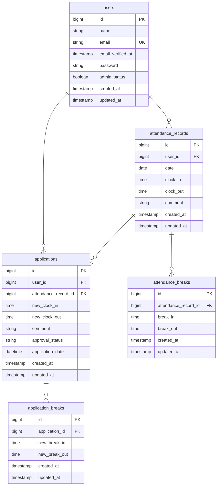

# アプリケーション名
勤怠管理アプリ

## 概要
Laravel 10 / MySQL / Docker / Laravel Sail を使用した勤怠管理アプリケーションです。
一般ユーザー向けの勤怠打刻機能（出勤・退勤・休憩）および勤怠修正申請機能、管理者向けの勤怠管理・申請承認機能を実装しています。
また、メール認証、CSVエクスポート、勤怠集計レポート機能、公開APIを実装しています。

## 環境構築
このアプリケーションは Docker / Laravel Sail を使用して動作します。
ホストマシンに PHP や Composer をインストールする必要はありません。

ただし、初回のみvendor を生成する必要があるため、Composer を Docker コンテナ経由で実行します。  
（ホストに Composer をインストールする必要はありません）
※1～8に初回のみ実行、一度設定後は`attendance-app`で以下を実行することで実行可能
```bash
./vendor/bin/sail up -d
```
### 1.リポジトリのクローン

```bash
git clone git@github.com:aridome-sashizume/attendance-app.git
cd attendance-app
```
### 2.Composer インストール
`.env.example` は Sail 用の DB 設定済み です。

```bash
cp .env.example .env
```

### 3. Composer install（ホストに Composer 不要）
```bash
docker run --rm \
  -u "$(id -u):$(id -g)" \
  -v "$(pwd):/var/www/html" \
  -w /var/www/html \
  -e COMPOSER_CACHE_DIR=/tmp/composer_cache \
  laravelsail/php82-composer:latest \
  composer install
```


### 4. Laravel Sailの設定を生成（mysql、mailpit）
```bash
docker run --rm -u "$(id -u):$(id -g)" -v "$(pwd):/var/www/html" -w /var/www/html \
  laravelsail/php82-composer:latest \
  php artisan sail:install --with=mysql,mailpit
```

### 5. Sail の起動
```bash
./vendor/bin/sail up -d
```

### 6.フロントエンドのセットアップ（Tailwind CSS を含む）
Tailwind CSS はすでにプロジェクトに含まれています。
また、別タブで実行してください。
```bash
./vendor/bin/sail npm install
./vendor/bin/sail npm run dev
```


### 7. アプリケーションキー生成
```bash
./vendor/bin/sail artisan key:generate
```

### 8.データベース初期化
サンプルデータを含めた初期状態を構築するため、マイグレーションとシーディングを実行します。
```bash
./vendor/bin/sail artisan migrate:fresh --seed
```

### 9.アクセスURLを開く
- 一般ユーザー:http://localhost/login
- 管理ユーザ：http://localhost/admin/login
    
### 実行終了時は、以下のコマンドでSailを終了してください。
```bash
./vendor/bin/sail down
```

## テストユーザー

### 一般ユーザー

| メールアドレス | パスワード |
|---|---|
| user1@example.com | password |
| user2@example.com | password |

### 管理者

| メールアドレス | パスワード |
|---|---|
| user3@example.com | password |

## 認可
- 一般ユーザーは自身の勤怠情報のみ閲覧可能
- 一般ユーザーは管理者画面へアクセス不可（403 Forbidden）
- 管理者は全ユーザーの勤怠情報を閲覧・編集可能

## 公開API

### ベースURL

```text
http://localhost/api/v1
```

### エンドポイント

| メソッド | URL | 概要 |
|----------|-----|------|
| GET | /attendance-records | 勤怠一覧取得 |
| GET | /attendance-records/{attendanceRecord} | 勤怠詳細取得 |
| POST | /attendance-records | 勤怠登録 |
| PUT/PATCH | /attendance-records/{attendanceRecord} | 勤怠更新 |
| DELETE | /attendance-records/{attendanceRecord} | 勤怠削除 |

## ER図


## URL
- アプリ開発環境
    - 一般ユーザー:http://localhost/login
    - 管理ユーザ：http://localhost/admin/login
- phpMyAdmin: http://localhost:8080
- Mailpit: http://localhost:8025

## 使用技術（実行環境）
- Laravel 10.50.3
- PHP 8.2
- MySQL 8.4
- Docker / Laravel Sail
- Nginx
- Tailwind CSS 3.4
- Vite
- Git
- GitHub
